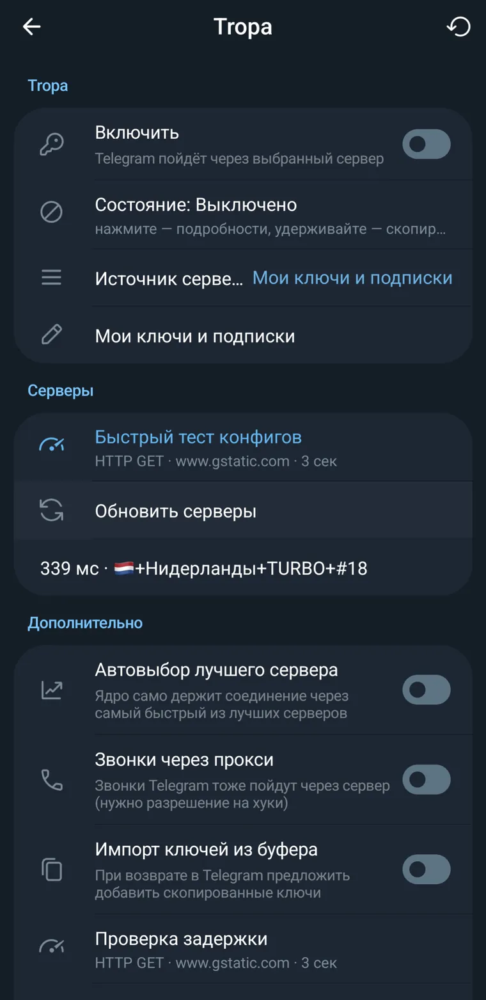
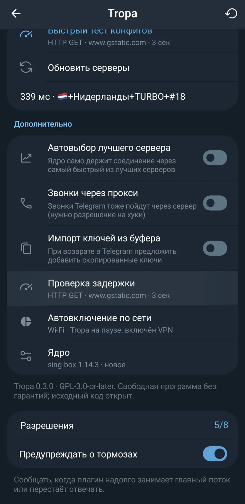
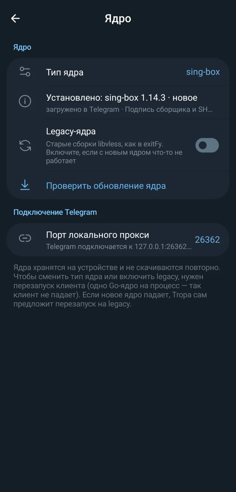

# Tropa

[English version](https://github.com/palmdm/Tropa/blob/main/README_EN.md)

## Описание

Плагин для доступа к Telegram из мест, где Telegram может работать некорректно. Предназначен для клиентов, поддерживающих плагины (Aprel Gram, exteraGram, AyuGram). Заимствует некоторые идеи плагина exitFy (устаревшей версии) с улучшениями, исправлениями и новыми функциями. Протестирован и рекомендован для использования с Aprel Gram.
Пускает Telegram через локальное ядро **sing-box** или **Xray**: клиент подключается к SOCKS5 на `127.0.0.1`, ядро ведёт трафик через выбранный сервер.

## Возможности

- **Ключи и подписки:** vless (tcp, ws, grpc, httpupgrade, xhttp; tls, reality), vmess, trojan, shadowsocks (включая 2022), hysteria2, tuic. Подписки в виде base64 или списка ссылок; показываются трафик, срок и название профиля. Если обновление подписки не удалось, список серверов остаётся прежним.
- **Встроенный провайдер elix.**
- **Одна запись в списке прокси Telegram:** постоянные порт и логин, порт можно задать вручную. Старые записи Tropa удаляются сами, прежний прокси пользователя возвращается при выключении.
- **Быстрый тест конфигов:** TCP Connect, ICMP, HTTP GET / HEAD (реальная задержка через сам сервер). Hysteria2 и TUIC проверяются и TCP-методом: TCP на тот же порт, затем ICMP. Пинг можно показывать цифрами, шкалой, шкалой с цифрами или точками; есть пресеты адреса для теста и таймаут.
- **Автовыбор лучшего сервера:** `urltest` в sing-box, `balancer` + `observatory` в Xray.
- **Автовключение по сети:** работа на Wi-Fi и мобильной сети настраивается отдельно, при включённом VPN плагин встаёт на паузу. Переключатель «Включить» остаётся за пользователем.
- **Звонки через прокси:** локальный SOCKS5 подставляется в `Instance.makeInstance`.
- **Импорт ключей из буфера обмена** при возврате в Telegram. Предлагаются только новые ключи.
- **Пункт в меню Telegram:** в левом меню (и в меню чата) появляется «Настройки Tropa» — быстрый переход к настройкам.
- **Диагностика в пункте «Состояние»:** нажатие — подробности и копирование полного отчёта с журналом (без ключей и паролей); удержание — сразу скопировать отчёт.

## Установка

Загрузите файл `tropa.plugin` в клиент Telegram  (Aprel Gram, exteraGram, AyuGram) и нажмите на него для начала установки. Дайте добро для всех разрешений и установите.

## Скриншоты

<p align="center">
  
  
  
</p>

## Ядра

Ядра не входят в плагин. Нужное ядро скачивается само при первом подключении (≈30 МБ) и дальше хранится на устройстве: каждая сборка лежит в своём файле (`<тип>-<канал>.so`), поэтому переключение типа ядра или legacy ничего не скачивает повторно.

- **Новые (по умолчанию).** Релизы [itsv1eds/exitFy](https://github.com/itsv1eds/exitFy/releases): на момент выпуска sing-box 1.13.20 и Xray 26.7.28. `manifest.json` релиза проверяется подписью сборщика (ECDSA P-256, проверка на чистом Python), сам файл — по SHA-256 из манифеста. Зеркала GitHub используются только для таких проверяемых файлов. Доступны для arm64 и Android 10+.
- **Legacy.** Старые сборки libvless из [itsv1eds/itsv1eds](https://github.com/itsv1eds/itsv1eds/releases), как в exitFy. Включаются переключателем «Legacy-ядра» или сами, если новое ядро падает при запуске: тогда Tropa подключается через legacy, сохраняет текст ошибки для отчёта и не запускает упавшую сборку, пока не выйдет новая или пользователь не нажмёт «Снова пробовать новое ядро».

**Одно Go-ядро на процесс.** Выгрузить нативную библиотеку из процесса нельзя, а два Go-рантайма в одном процессе конфликтуют по обработчикам сигналов и могут уронить клиент (именно это роняло клиент при переключении ядер в ранних версиях). Поэтому первое выбранное ядро загружается и остаётся единственным, а смена типа ядра или включение legacy применяется через перезапуск клиента — Tropa предлагает его одной кнопкой (перезапуск такой же, как делает сам Aprel Gram: запускает клиент заново и завершает старый процесс). Пока нужное ядро совпадает с уже загруженным, переподключение идёт без перезапуска. Библиотеки грузятся локально (`RTLD_NOW` без `RTLD_GLOBAL`). Обновление уже загруженного ядра скачивается заранее и применяется при следующем запуске; в фоне обновления скачиваются только в безлимитной сети.

Если новое ядро не запускается, Tropa отмечает сборку, сохраняет текст ошибки и несколько коротких проверочных запусков (видно в отчёте, на чём именно падает), и предлагает перезапуск, чтобы подняться на legacy-ядре. Если выбранный сервер работает только с другим ядром (hysteria2 и tuic — только sing-box), Tropa переключает ядро сам; такие серверы всегда видны в списке с пометкой «только sing-box».

## Ограничения

- Режим TG WS (без серверов) пока не реализован: это отдельный мост MTProto-over-WebSocket, который нужно доводить и проверять на устройстве.
- sing-box не поддерживает xhttp. Xray в этом плагине не поддерживает hysteria2 и tuic. Shadowsocks с плагинами (obfs, v2ray-plugin) не поддерживается.

## Сборка

```bash
python3 build.py
```

Скрипт склеивает `src/NN_*.py` по порядку в `dist/tropa.plugin` и проверяет синтаксис.

## Тесты

Тесты запускают плагин на компьютере с подделками SDK Aprel Gram и классов Telegram. Подделки повторяют то, что ломалось на устройстве: `java.util.ArrayList` в Chaquopy Aprel Gram нельзя перебирать в `for`, `SharedConfig` устроен как в Aprel Gram, настройки переживают перезапуск. Вместо ядер — маленькие библиотеки с тем же C-интерфейсом (`StartCore`/`StopCore`), которые запускают настольный sing-box с тем же конфигом.

Нужны Python 3.11, `requests`, `gcc`, `openssl` и sing-box 1.13 с `with_utls` и `with_quic`:

```
SING_BOX=/path/to/sing-box tests/run_all.sh
```

| Тест | Что проверяет |
|---|---|
| `t_configs` | конфиги всех протоколов проходят `sing-box check` (1.13.14, 1.13.19, 1.13.20) |
| `t_runtime` | одна запись прокси, трафик через каждый протокол, быстрый тест, переключение ядер, откат на legacy, перезапуск, копирование ошибок |
| `t_cores` | подписанная загрузка один раз, переключения без загрузки, обновления, подделанные релизы, перенос со старой раскладки |
| `t_proxy` | форки без геттеров, записи после перезапуска, действия пользователя в настройках прокси, занятый порт |
| `t_ui` | все страницы настроек в разных состояниях, подписки, буфер обмена |

## Сторонние лицензии

Сторонние компоненты скачиваются во время работы и в репозиторий не входят:
- сборки sing-box — GPL-3.0-or-later;
- обёртка сборок itsv1eds — MIT;
- Xray-core — по лицензии проекта XTLS.
